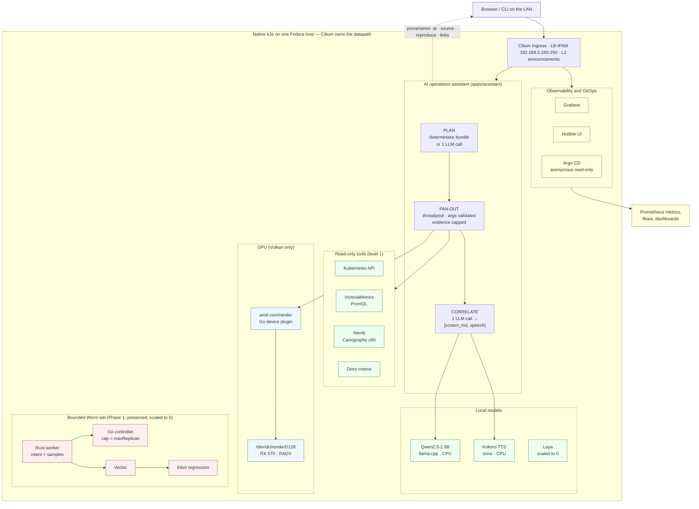
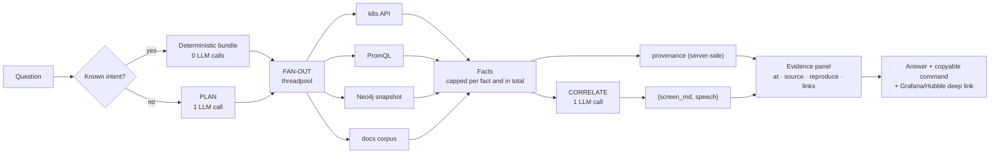

# A single-host cluster that grew up: k3d → native k3s → GPU → AI Ops

This repository is one research lab that changed shape four times. It began as a
bounded **self-replication** experiment on a throwaway `k3d` cluster, became a
**native `k3s`** platform on a real Fedora host when the container kernel could
not carry Cilium's datapath, added an **AMD GPU** and local **CPU models**, and
finally grew an **AI operations assistant** that explains the running cluster
with evidence an operator can check.

Everything below runs on **one host** (`192.168.0.28`, Fedora 44, kernel 6.19,
i5-9400F, 15 GiB RAM with zram, AMD RX 570). It is a lab, not a product.

> **Where to start:** [`ROADMAP.md`](ROADMAP.md) for current state and open work
> → [`evolution/`](evolution/README.md) for why each layer exists, with commits →
> [`research/`](research/) for design notes → [`benchmark/`](benchmark/README.md)
> for the measurements.

## Bare metal only — never a VM, never Vagrant

**Read this before running anything.** The cluster runs on the physical machine,
not in a VM, Vagrant box, QEMU/KVM domain, VirtualBox/VMware guest, or a
container. On this host that is verifiable:

```bash
systemd-detect-virt     # -> none        (you are on bare metal)
lsmod | grep amdgpu     # -> amdgpu, in use
ls -l /sys/class/drm/   # -> card1 on 0000:01:00.0, with DP/DVI connectors
```

Two reasons, and the second one can cost you the graphics card:

1. **Cilium's eBPF datapath needs the host kernel.** The Phase-1 `k3d` profile
   ran inside Docker and could not use it — it fell back to iptables
   masquerading and host-legacy routing (`bb93f8e`), which is precisely why that
   phase ended.
2. **The GPU is the host's display GPU.** `/dev/dri/renderD128` is bound to the
   host `amdgpu` driver — that is the device the Track C plugin hands to pods.
   A VM with GPU passthrough rebinds the card to `vfio-pci` **on the host**,
   which takes it away from your session: no display, no Vulkan, and it stays
   away until the binding is undone and the machine reboots. On a single-GPU
   desktop, "wrongly used" here means the card looks gone.

So: don't pass the GPU to a guest, don't edit `vfio-pci` ids into the kernel
command line, don't blacklist or unbind `amdgpu`, and don't run the cluster in
Docker/Podman. `AGENTS.md` makes all of that a hard prohibition for agents, with
the read-only probes that remain allowed.

**But if you need no GPU access, a VM is fine.** The rule exists *because of the
card*, not as a principle: wrap the cluster in Vagrant or QEMU/KVM and nothing
breaks, as long as you don't attach the GPU to the guest and don't touch the
host's driver bindings. That is the intended way to try this platform on a
machine without an AMD card — or to develop the GKE/GCE path described in
[`research/production-hosting-gke-gce.md`](research/production-hosting-gke-gce.md).
One question decides it: *does the work need `/dev/dri/renderD128`?* No → VM is
fine. Yes, or unsure → bare metal.

Nested `k3d` is still Phase-1 history, not an alternative profile: it fakes the
datapath, so its results describe the shim.

## What this is, and what it is not

| It is | It is not |
|---|---|
| A reproducible single-host Kubernetes lab where every claim is traceable to a commit or a measurement | A production distribution, an HA cluster, or a template to copy |
| A worked example of Cilium eBPF, LB-IPAM, GitOps, device plugins, and local inference on modest hardware | An Internet-facing service — it is LAN-only and mostly unauthenticated |
| A record of five pivots, including the ones that failed and why | A polished product with stable APIs |

## Architecture at a glance



Two systems share one cluster: the **assistant** reads infrastructure and
explains it; the **Worm lab** exercises bounded self-replication. Neither holds
write credentials on its read path.

## The five phases

Full narrative and commit evidence: [`evolution/`](evolution/README.md).

| Phase | When | What it settled |
|---|---|---|
| **1 — Bounded Worm on k3d** | 2026-09-05 → 09-07, `main` | Replication can be capped and proven: the controller owns scale, `spec.maxReplicas` holds, and an over-cap request stays pending instead of bypassing the cap. Ended because the k3d kernel could not run Cilium's eBPF datapath. |
| **2 — Native k3s (Track A)** | 2026-10-06 | The same components on a real kernel: Cilium LB-IPAM replaces MetalLB, a cluster-owned `resolv-conf` replaces host DNS, and images arrive through an in-cluster registry with no root. |
| **3 — CPU models (Track B)** | 2026-10-06 | A local model is an ordinary workload. Policy: every model starts on CPU because RAM (~9 GiB free), not CPU or GPU, is the binding constraint. |
| **4 — AMD GPU (Track C)** | 2026-10-06 → 10-18 | A protocol with an early stop: `/dev/dri` **yes**, Vulkan **yes**, ROCm/CUDA **no** on gfx803. The device plugin schedules and mounts the GPU; it cannot enforce per-pod VRAM. |
| **5 — AI Ops (Track D)** | 2026-10-06 → 10-12 | An LLM can explain a cluster *if the evidence is attached server-side and the output fails closed*. Two inference calls per answer, read-only RBAC, one human-confirmed action path. |

Historical branches are kept, not rewritten: `main` is frozen at Phase 1,
`trackc` holds the worm-lab line, and **`cluster-evolution`** merges both lines
on top of `native-k3s-gpu-models` (merge commit `9b449fe`).

## What is running right now

Argo CD reconciles 12 Applications, all `Synced / Healthy`. Exposure is by bare
Cilium LoadBalancer IP on the LAN — no DNS, no ingress hostnames, no `/etc/hosts`.

| UI / API | Address | Notes |
|---|---|---|
| Argo CD | <http://192.168.0.247/> | anonymous **read-only** (`policy.default: role:readonly`), admin disabled, never `server.disable.auth` |
| Grafana | <http://192.168.0.245/> | Cilium/Hubble dashboards, no login |
| VictoriaMetrics | <http://192.168.0.246/> | PromQL store scraped by Grafana |
| Hubble UI | <http://192.168.0.241/> | flow visibility for every namespace |
| Assistant API | <http://192.168.0.243/> | `POST /chat`, plus an evidence panel and a chat UI |
| Neo4j Browser | <http://192.168.0.242/> | Cartography graph, `NEO4J_AUTH=none`, re-synced every 6 h |
| Cilium Ingress | `192.168.0.240` | shared ingress, class `cilium` |

Workloads by namespace:

| Namespace | Running | Scaled to 0 |
|---|---|---|
| `assistant` | `assistant`, `assistant-e4-gpu` | `assistant-laya`, `assistant-e4-cpu` |
| `models` | `llm` (Qwen2.5-1.5B), `kokoro` | `laya` |
| `observability` | `grafana`, `victoriametrics` | — |
| `cartography` | `cartography-neo4j` + 6-hourly sync | — |
| `fuwa` | `fuwa`, `loki`, `otel-collector`, `tempo` | — |
| `worm-lab` | — | `worm-controller`, `worm-worker`, `vector`, `regression` |

`fuwa` and the E4 A/B assistant are deployed by hand and are **not** Argo
Applications yet — a reproducibility gap tracked in [`ROADMAP.md`](ROADMAP.md) §4.

## The AI operations assistant

`apps/assistant/` answers infrastructure questions *with the evidence attached*,
so the operator can check the answer instead of trusting it.



- **Two LLM calls, not one per tool.** A small labeled plan catalog
  (`_PLAN_CATALOG` in `apps/assistant/pipeline.py`: unhealthy, traffic, drop,
  topology, snapshot, default) answers common questions with zero inference, and
  the fallback is one plan call plus one correlate call that emits the screen
  text and the spoken line together.
- **The model never sees the provenance.** `at`, `source`, `reproduce` and
  `links` are attached server-side after the tools return. They cost zero tokens
  and the model cannot fabricate a link.
- **Fail closed.** A malformed reply is never returned as the answer: the
  `{screen_md, speech}` shape is validated, retried once, and degrades to a clean
  digest of the evidence actually gathered.
- **Read-only by construction.** 11 tools, 10 of them read-only (`get`/`list`/
  `watch` on a fixed resource set plus `get` on `pods/log`). The only mutating
  one, `propose_action`, mints a single-use 120-second confirmation token;
  execution needs a human `POST /actions/confirm` **and** `rbac.allowActions`.
- **Bounded concurrency.** An in-process limit plus a bounded FIFO queue in
  front of the LLM, so a burst of chat turns cannot stampede a 1.5B model running
  on six CPU threads.

Unit tests run without a cluster or a model:

```bash
cd apps/assistant && python3 -m pytest -q
```

Design notes, failure catalogue and benchmarks:
[`research/features/`](research/features/README.md),
[`research/assistant-response-pipeline.md`](research/assistant-response-pipeline.md),
[`benchmark/`](benchmark/README.md).

## The GPU verdict, in one table

| Node | Backs | On RX 570 (Polaris, gfx803) |
|---|---|---|
| `/dev/dri/renderD128` | graphics, **Vulkan**, video (Mesa RADV / VA-API) | ✅ mounted into pods, Vulkan inference works |
| `/dev/kfd` | AMD **compute** (ROCm) | ❌ outside ROCm's support matrix — never mounted |

`apps/gpu-device-plugin/` advertises `amd.com/render`, so the GPU is a
**schedulable, counted resource** with automatic device mounting instead of a
raw `hostPath`. It does **not** provide per-pod VRAM quotas: a slice model
(`amd.com/vram-gb`) makes admission *advisory* only, because raw
`amdgpu`/Vulkan on gfx803 exposes no per-process memory limit. Anything in this
repository called "GPU work" means Vulkan on an unsupported Polaris card.

## The bounded Worm lab (Phase 1, preserved)

The original experiment still builds and still runs on a Docker host; it is
scaled to 0 in the live cluster because the phase is complete.

1. Each worker starts with its Pod UID as `WORM_ID` and sends a single
   idempotent replication intent, retrying at most five times.
2. The controller records distinct intent IDs and owns every scale change,
   never exceeding `spec.maxReplicas`.
3. Workers write JSON samples to stdout; Vector reads the pod logs off the node
   and posts them to the Elixir regression service.
4. Regression de-duplicates `{worm_id, sequence}` in a 60-second window and
   serves the rolling linear regression.

Workers hold no Kubernetes credentials and cannot scale themselves. The
namespace `ResourceQuota` (`worm-worker-cap`) makes an over-cap request stay
pending rather than find another way in. Write-ups: [`blog/`](blog/).

## How to run it

There are three entrypoints, and they target **different** clusters. Read the
one you want before running anything.

**Native k3s (the live profile).** Needs a Fedora-class host with systemd and
eBPF. `config/k3s/` installs k3s, Cilium, LB-IPAM and the exposure stack; the
Applications are registered afterwards — see
[`config/k3s/README.md`](config/k3s/README.md) and
[`config/argocd/README.md`](config/argocd/README.md) first.

```bash
bash config/k3s/bootstrap.sh                       # k3s + Cilium + LB-IPAM + observability
kubectl apply -f config/argocd/applications/       # register the Applications
```

**k3d (Phase 1 profile, archived but runnable).** Destructive: deletes and
recreates the cluster named `cilium-lab`, then installs Cilium, Hubble, Argo CD,
MetalLB and the Worm workloads.

```bash
bash start.sh
```

**Tilt (k3d only, human-operated).** The root `Tiltfile` targets the
`k3d-cilium-lab` context; it does not create the cluster and does not apply to
the native k3s profile.

> **Tilt is human-only.** Agents and automation must not run `tilt up`,
> `tilt down`, or otherwise control a Tilt process — see [`AGENTS.md`](AGENTS.md).

## GitOps rules that are not negotiable

- Argo CD Applications **read the branch their work lives on** — never `main`.
  Today: 7 read `native-k3s-gpu-models`, 6 read `trackc`, and 4 pinned
  Applications under `config/argocd/applications/stable/` read a full commit with
  manual sync only. Promotion to `cluster-evolution` is the next step, not an
  accident (see [`ROADMAP.md`](ROADMAP.md) §4).
- **Two reconcilers never own one resource.** The pinned `stable/` bundle and the
  Tilt-driven Worm resources describe the same objects; registering both is a
  bug.
- **`server.disable.auth: "true"` is forbidden.** It grants the Admin role to
  every anonymous caller. Read-only comes from
  `users.anonymous.enabled` + `policy.default: role:readonly` in
  `config/argocd/values.yaml`, so a Helm reinstall cannot downgrade it silently.

## Configuration knobs worth knowing

| Concern | Where | Why it matters |
|---|---|---|
| k3s server flags | `config/k3s/config.yaml` | Flannel/kube-proxy/Traefik/ServiceLB disabled so Cilium owns networking; `bind-address` must stay **unset** or pods lose the API and DNS |
| LB pool | `config/k3s/cilium-lb-ipam.yaml` | `192.168.0.240-250` on the LAN; adjust `blocks` only |
| Argo CD posture | `config/argocd/values.yaml` | anonymous read-only, admin disabled |
| Cilium values | `config/helm/cilium/values.yaml` | k3d-specific masquerading/routing has no place in the native profile |
| Image delivery | `config/registry/`, `config/k3s/import-image.sh` | rootless build → in-cluster registry → k3s pull |
| Memory budget | `apps/models/*/chart/values.yaml` | Laya needs 6 GiB; on a 15 GiB host that is the whole budget |

## Verification

```bash
bash config/ci/validate.sh                            # Helm charts + kubeconform for config/ and apps/
cd apps/assistant && python3 -m pytest -q             # assistant unit tests, no cluster needed
kubectl get applications -n argocd                    # what GitOps thinks is true
kubectl get svc -A | grep LoadBalancer                # what the LAN can actually reach
```

CI (`.github/workflows/validate.yaml`) runs `config/ci/validate.sh` on pushes to
`main` and on pull requests. It does **not** yet validate the native k3s profile
end to end, and `config/ci/validate.sh` still pins a Cilium chart that predates
`kubeProxyReplacement` — both tracked in [`ROADMAP.md`](ROADMAP.md) §4.

## Known limits — stated, not hidden

- One host, one node, no HA, no TLS, no auth on Neo4j, Grafana deliberately
  login-free. Anonymous read-only is a **lab** posture, not a public-IP design.
- The GPU is Vulkan-only: no ROCm, no CUDA, no VRAM enforcement.
- The models fit only with browsers closed; zram swap is a cushion, not capacity.
- Benchmarks are single-host measurements tied to a recorded baseline commit.
- Exposure is LAN-only: it relies on a real L2 segment for `192.168.0.240-250`,
  so a routed cloud VPC (GKE/GCE) needs a different exposure path —
  [`research/production-hosting-gke-gce.md`](research/production-hosting-gke-gce.md).
- A public/VPS profile (Cloudflare Tunnel, deny-all firewall, `role:readonly`
  everywhere) is planned, not implemented, and lives in gitignored `docs/`.

Security-relevant exposure in this lab, explicitly accepted for LAN use: Grafana
without login, Neo4j with `NEO4J_AUTH=none`, and permissive CORS on the
unauthenticated assistant API so the external `fuwa` UI can call it
(`bd experiments-yc4`).

## Repository map

```text
ROADMAP.md               current state, phases, open work, limits
evolution/               per-phase narrative + commit evidence index
research/                tracked design notes and shipped feature docs
blog/                    Phase-1 write-ups (k3d, Worm, Tilt)
benchmark/               measured experiments: E2 planner A/B, E3 AMD GPU, E4 in progress
apps/
  assistant/             AI Ops assistant (pipeline, tools, provenance, voice, memory)
  assistant-laya/        isolated A/B variant (scaled to 0)
  models/{llm,kokoro,laya}  local models as Deployment + Service + Containerfile
  gpu-device-plugin/     Go device plugin advertising amd.com/render
  controller/ worker/ regression/   the bounded Worm lab
config/
  k3s/                   live profile: k3s, Cilium, LB-IPAM, exposure, validation
  k3d/                   Phase-1 profile (archived, still runnable)
  argocd/                Argo CD values + Applications (contextual targetRevision)
  cartography/ grafana/ victoriametrics/ vector/   platform services
  gpu/                   Vulkan smoke-test image + pods
  registry/ sealed-secrets/ metallb/ helm/ dns/ ci/
scripts/                 host-side helpers (image build/import, corpus, verification)
Tiltfile*  start.sh      Phase-1 entrypoints (k3d only, human-operated)
docs/                    gitignored, machine-specific runbooks
```

## Repository safety rules

This is a **public** repository. Never commit credentials, tokens, private keys,
kubeconfigs, certificates, or `.env` files. Commits are atomic and cite their
`bd` issue. Agents must not control Tilt, must not create or move git worktrees,
and must never point an Argo CD Application at `main`.

Read [`AGENTS.md`](AGENTS.md) before automating anything here. It opens with the
hardest rule in the repository: this cluster is **bare metal on the physical
host** — never a VM, Vagrant box, or container — because the GPU is the host's
own display card and a passthrough bind would take it away.
