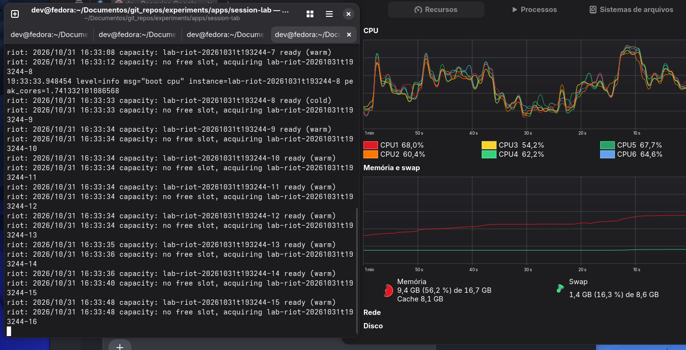
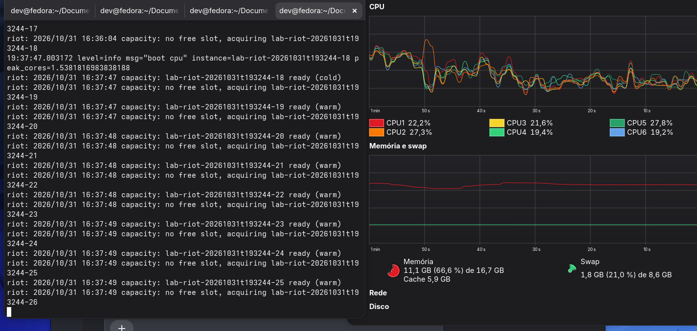
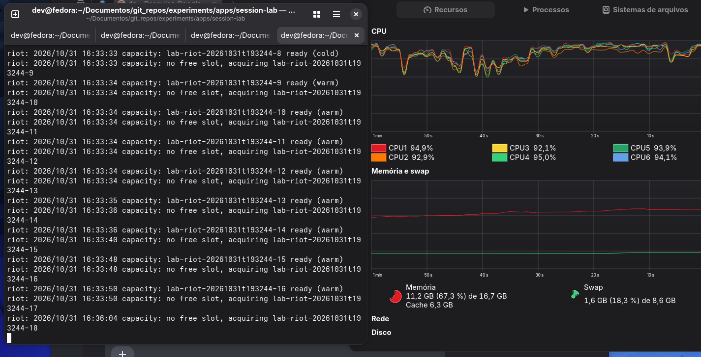
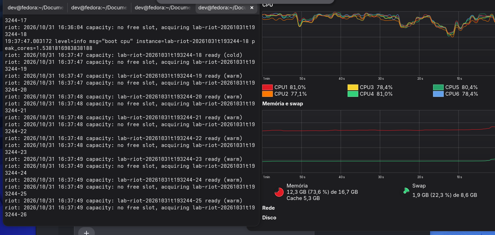
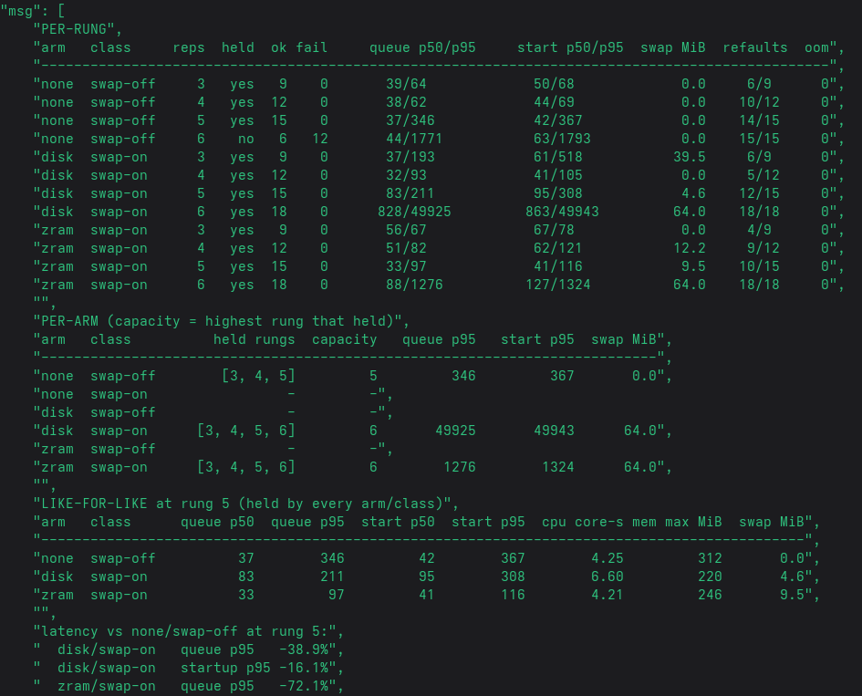

# The pitch

Registered data only. Every block below is quoted verbatim from a note in this
repository, with its source and line range underneath. Nothing here is computed,
summarised or interpreted — the narrative is written by the author in §10.

## 0. What we set out to do

> in resume we tried to scale Agentsandbox claim/sandbox pool past kubernetes
> cold start and allocation aiming for the maximum amount of served users
> possible

Cold boot **~40 s** · warm adoption **107 ms** · resume **p50 2853 ms** — [08.2 §6](research/session-lifecycle-elasticity/08.2-gpu-offload-feasibility.md), [07](research/session-lifecycle-elasticity/07-overload-and-suspend.md) lines 97–98.

What a claim bought at that point: agent-sandbox `v1.0.7` (pinned release, sha256-checked), a router + browser template + warm pool from `config/sandbox/`, and a Chromium-with-CDP image from `apps/browser-sandbox/` — [evolution/07](evolution/07-sandbox-console.md) lines 40–42.

## 1. What it is

```text
              Fedora 44 · Intel i5-9400F (6 threads) · 15 GiB RAM + 8 GiB zram
                        AMD RX 570 8 GB (also drives the desktop) · node 192.168.0.28
 ┌──────────────────────────────────────────────────────────────────────────────────────┐
 │  native k3s v1.36 · Cilium 1.20 only: eBPF, kube-proxy off, ingress + LB-IPAM .240-.250│
 └──────────────────────────────────────────────────────────────────────────────────────┘
      │                  │                     │                    │              │
 ┌────────────┐   ┌─────────────┐      ┌──────────────┐    ┌────────────┐  ┌───────────┐
 │agent-      │   │ session-lab │      │sandbox-      │    │observability│  │ platform  │
 │sandbox     │   │             │      │console       │    │             │  │           │
 │v1.0.7      │   │ runner      │      │.250          │    │Victoria     │  │Argo CD .247│
 │4 CRDs +    │   │ pool        │      │run + wall    │    │Metrics .246 │  │Kargo .249 │
 │controller  │   │ autoscaler  │      │views         │    │Grafana .245 │  │Neo4j .242 │
 │router +    │   │ slots       │      │tap = 1       │    │Hubble .241  │  │assistant  │
 │warm pool   │   │ CDP client  │      │screenshot    │    │             │  │.243       │
 │Chromium+CDP│   │ store, KPIs │      │traffic, cmp  │    │             │  │15 tools   │
 └────────────┘   └─────────────┘      └──────────────┘    └────────────┘  └───────────┘
```

Source: [`ROADMAP.md`](ROADMAP.md) §0 and §3, [`README.md`](README.md).

The cockpit drawing a run — four zooms of the same object, left to right:

<div class="shots-wrap">
<div class="shots" tabindex="0">

<figure>

<figcaption>Run overview — the skyline: sessions per 30 s bucket across a whole run</figcaption>
</figure>

<figure>

<figcaption>Wall zoom — buckets, instances and slots, in a valley between spikes</figcaption>
</figure>

<figure>

<figcaption>Wall zoom — the same view at the point the pool reached its CPU limit</figcaption>
</figure>

<figure>

<figcaption>Lane zoom — one instance's eight tracks while a Riot page drove CPU up</figcaption>
</figure>

</div>
</div>

## 2. GPU offload

> GPU acceleration does **not** raise concurrent session capacity on this node for the
> workload `session-lab` actually generates. The runner's hold is a sleep that samples
> cgroups; it never requests a frame, so headless Chromium renders nothing and the GPU has
> nothing to relieve. Measured node CPU was identical across arms: **1.53 vs 1.58 cores
> out of 6** at 30 concurrent sessions.
>
> The only case where the GPU moved a number is a forced render loop (40
> `Page.captureScreenshot` calls per session), which `session-lab` does not implement
> ([08 §9.2](research/session-lifecycle-elasticity/08.2-gpu-offload-feasibility.md) calls this the missing "drive phase"). There the
> GPU cut CPU per browser **2.13 → 1.57 cores (−26%)** while screenshot latency rose
> **244 → 279 ms (+14%)**.

Source: [`19-gpu-pool-a-b.md`](research/session-lifecycle-elasticity/19-gpu-pool-a-b.md) §1, lines 27–37.

<figure>

<figcaption>The visual stress test in the same lane view — eight tracks of one instance, rendering work in flight</figcaption>
</figure>

## 3. Overload run

> | Quantity | Measured |
> |---|---|
> | planned / stored | 60 / 60 |
> | outcomes | `success` 42, `acquisition_failed` 17, `reset_failed` 1 |
> | offered concurrency | 60.0 |
> | queue wait (claim → Ready) | p50 3.2 s, p95 134 s, p99 136 s, max 136 s |
> | memory | 154 MiB p50 peak, 209 MiB max, 168 MiB working-set max |
> | node memory | MemAvailable floor 3322 MiB of 15924 MiB (20.9%), swap used 4418 MiB, 195 samples |

Source: [`07-overload-and-suspend.md`](research/session-lifecycle-elasticity/07-overload-and-suspend.md) lines 34–48.

## 4. Slots

> | Scheduler (CPU requests) | ~21 browsers × 8 = **168 slots**; 27 if browsers had no neighbours | `FailedScheduling … Insufficient cpu` at 23:59 with 21 instances |

> So the honest statement is: **168 concurrent contexts is the slot ceiling on this node,

Source: [`18-capacity-elasticity-and-kine.md`](research/session-lifecycle-elasticity/18-capacity-elasticity-and-kine.md) lines 62 and 67.

## 5. Capacity arithmetic, as registered

> ```
> sessions/s = concurrent slots / mean hold
> ```
>
> | Bound | Concurrency | sessions/s | sessions / 24 h |
> |---|---|---|---|
> | Slots | 168 | 2.24 | 193 500 |
> | CPU, measured 2.0 core-seconds per session over ~2.7 free cores | 135 | 1.35 | 116 600 |
> | Control plane (what actually broke) | — | ~2 | ~170 000 theoretical, **0 observed** |
> | A defensible soak target | 75 | 1.0 | 86 400 |

Source: [`18-capacity-elasticity-and-kine.md`](research/session-lifecycle-elasticity/18-capacity-elasticity-and-kine.md) §2, lines 74–83.

## 6. Lifecycle and autoscaling

> | queue wait p50 / p95 | 3.2 s / 134 s | **85 s / 209 s** | **1.4 s / 54 s** |
> | reset p50 / p95 | 35 ms / 625 ms | — | 39 ms / 531 ms |
> | release (delete) p50 / p95 | — | **374 ms / 7.07 s** | — |
> | replica trajectory | 2 → 22 → **40** (configured max), then back to 2 after the run |

Source: [`09-results-three-runs.md`](research/session-lifecycle-elasticity/09-results-three-runs.md) lines 42–44 and 80.

<figure>

<figcaption>Warm claim against a raw sandbox — reset p50 35 ms versus delete p50 374 ms (p95 7.07 s) plus a cold start</figcaption>
</figure>

> | 17:16:18 | 22 | 22 | `scale-out complete: 22 ready after 84.9s` |

Source: [`10-autoscaler-deployed.md`](research/session-lifecycle-elasticity/10-autoscaler-deployed.md) line 56.

## 7. Swap and zram

> **YES, by one concurrent session: 5 → 6 (+20 %)** at 3 vCPU / 4 GiB, and with zram
> it also cuts tail latency ~70 % at equal load (§5b).

> **[M] Swap buys exactly one more concurrent session: 5 → 6, +20 %**, i.e. 15 → 18
> sessions/min at a 20 s hold. Not more, on this box.

> | `zram-2to1` | lz4 | 39 409 ms | **31/31 ok** | **6.38** | **7** |
> | `zram-5to1` | zstd | **740 ms** | 24 ok, 7 failed (API `Delete` timeout) | 7.25 | 6 |
> | **latency at rung 6** — same 27 sessions, same box | **zstd (5:1)**: 740 ms vs 22.7 s vs 39.4 s p95 | 30–50× better |

Source: [`swap-capacity/README.md`](research/swap-capacity/README.md) lines 23–24, 141–142, 303–312.

<figure>

<figcaption>The ratio run — the benchmark capture behind the table above</figcaption>
</figure>

## 8. Control plane

> | Status | §8 fix applied and measured on the live node 2026-11-01 (`_synchronous=NORMAL&_busy_timeout=30000`): insert mean 64.6 → 2.06 ms, 823 Slow SQL/hour → 0, 9 fatals/24 h → 0 |

> | `Slow SQL` (threshold 1 s) | 823 / hour | **0** | `journalctl -u k3s` |

Source: [`05-write-ceiling-and-fixes.md`](research/cpu-oversubscription/05-write-ceiling-and-fixes.md) lines 15 and 331.

## 9. Per-session footprint

> | Pod cgroup `memory.current` | 559 MiB | `03-browser-density.md:187` |

Source: [`13-client-go-apf-and-density-limits.md`](research/session-lifecycle-elasticity/13-client-go-apf-and-density-limits.md) line 92.

## 10. The narrative

Author writes here.
