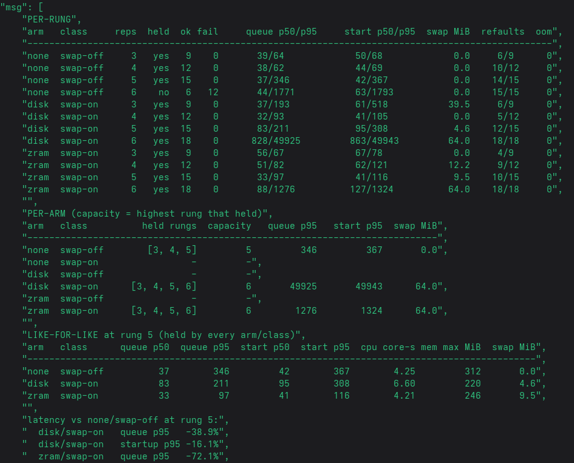
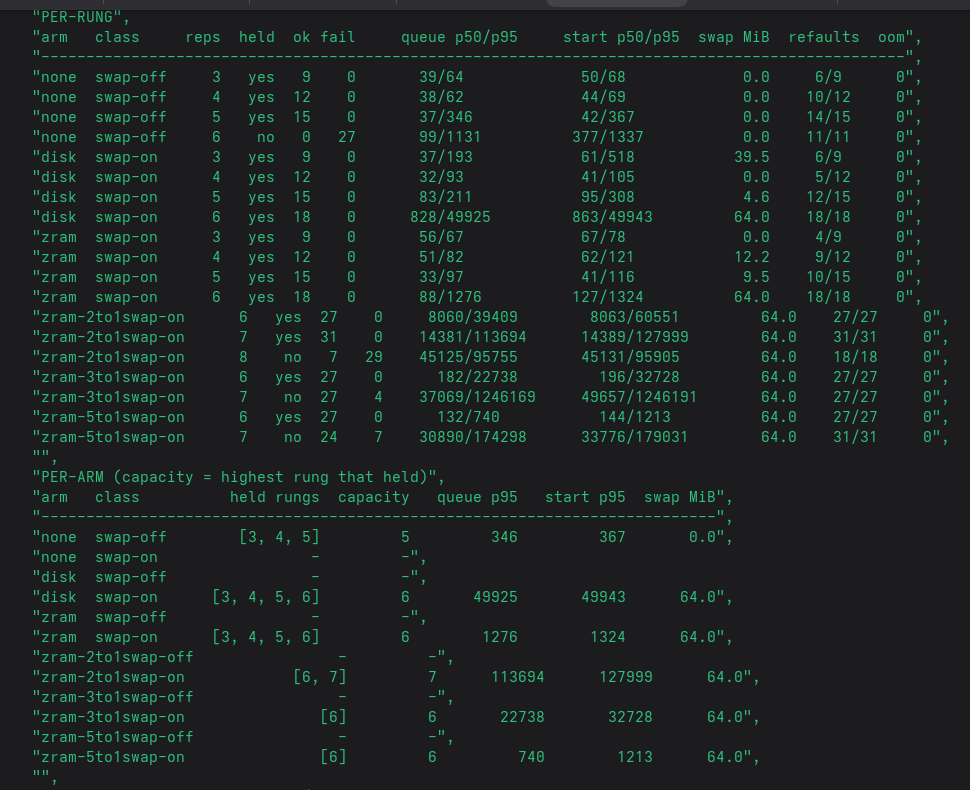

# Memory compression — screenshots on file, write-up pending

Two captures exist from the 2026-11-02 / 2026-11-03 sessions. The notes for them
have not been written yet; this file exists so the images have a home and are not
lost in a screenshot folder.

*The benchmark capture (2026-11-02).*

*The algorithm comparison capture (2026-11-03).*

What is missing: which algorithms were compared, on what host and input, what the
numbers were, and which of them the platform took. Until that is measured and
recorded, treat the pictures as the only artefact.
