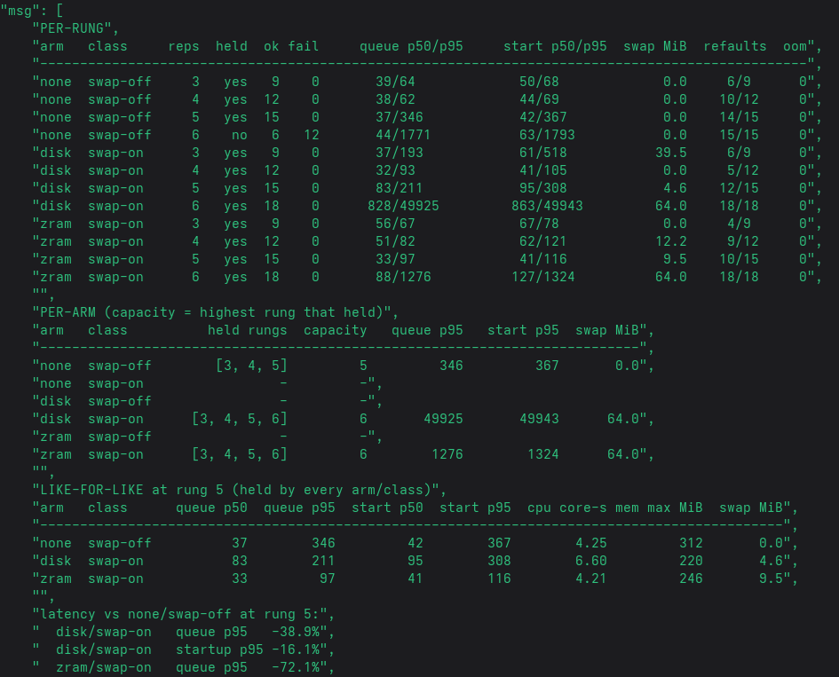
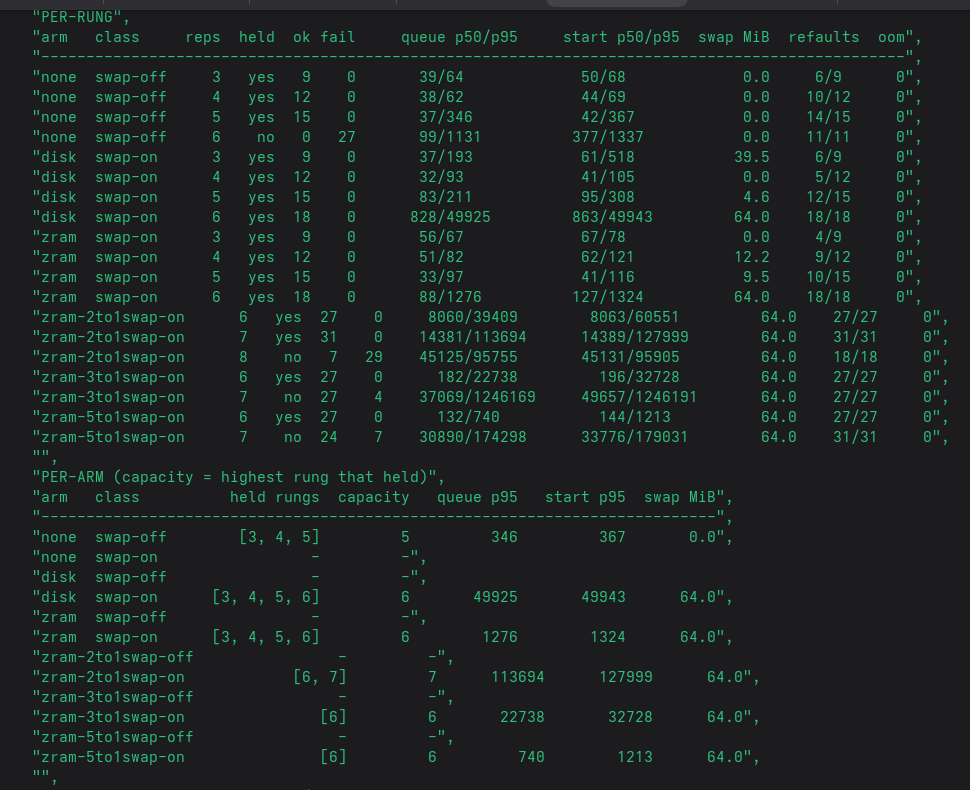

# Swap as capacity for Chromium sandbox sessions

Findings from the swap experiment run in a disposable k3s VM
(`config/vm-swap-lab/`). Every number here is labelled:

| Tag | Meaning |
|---|---|
| **[M]** | measured in this lab, on this host, in a run whose artefact is named |
| **[D]** | documented upstream (Kubernetes KEP / docs / kernel docs) |
| **[I]** | inferred from measurements, stated as an inference |
| **[U]** | unknown — the evidence to settle it was not produced |

Two questions were asked, both now answered:

1. **Can swap be used for these workloads at all?** — **YES [M]**, mechanically proven (§3).
2. **Does swap raise capacity (sessions served concurrently) and by how much?** —
   **YES, by one concurrent session: 5 → 6 (+20 %)** at 3 vCPU / 4 GiB, and with zram
   it also cuts tail latency ~70 % at equal load (§5b). The earlier "not measured"
   state, and the harness bug behind it, are kept in §5c as the record of what had
   to be fixed first.

Still open: **which compression ratio** (2:1 / 3:1 / 5:1) gives that latency win at
the lowest CPU cost — the design for that run is §5d.

---

## 1. Setup

| Item | Value |
|---|---|
| Host | Fedora, Intel i5-9400F, 15 GiB RAM, KVM available to the agent shell |
| VM | QEMU, Ubuntu 24.04 cloud image, kernel 6.8.0-147, sizes `CPUS=2/4`, `MEM_MB=2048/3072` |
| Kubernetes | k3s **v1.36.5+k3s1**, containerd 2.3.4, cgroup v2 |
| Swap | zram, `zram-size = ram / 2`, zstd |
| Kubelet | drop-in `/var/lib/rancher/k3s/agent/etc/kubelet.conf.d/90-swap.conf`: `failSwapOn: false`, `memorySwap.swapBehavior: LimitedSwap` |
| Workload | upstream `chrome-sandbox:latest-main`, one headless Chromium per pod, CDP on `127.0.0.1:9222` |
| Template | `requests.cpu 100m`, `requests.memory 256Mi`, `limits.memory 768Mi` → **Burstable** |
| Harness | `apps/session-lab`, `--policy destroy` (one sandbox per session), 20 s or 30 s holds |

Why a VM: `memorySwap` is a kubelet-wide setting and the host's own sandbox pods run
`restartPolicy: Never`, so toggling it on the live node restarts containerd and kills
them. Inside the VM the same change costs one `systemctl restart k3s`.

---

## 2. What "per-pod swap" actually is

**[D]** `memorySwap.swapBehavior` is a `KubeletConfiguration` field with no kubelet
flag, so it arrives as a config drop-in. Two modes were exercised:

| Kubelet setting | browser container `memory.swap.max` | Meaning |
|---|---|---|
| `NoSwap` | **`max`** | kubelet writes no limit; the cgroup default applies — *unconstrained*, not forbidden |
| `LimitedSwap` (4 GiB VM) | **133.9 MiB** = `(256/3915) × 2047` | the documented request-proportional formula |
| `LimitedSwap` (2 GiB VM) | **0** | same template, same kubelet setting, zero allowance |

**[M]** The `NoSwap` row is the important one: a "no swap" kubelet is not a no-swap
workload. Any experiment that compares `NoSwap` with `LimitedSwap` compares
*unconstrained* with *request-proportional*, which is not the question.

**[M]** The allowance is written at the **container scope**
(`kubepods-…-pod<uid>.slice/cri-containerd-<id>.scope/memory.swap.max`), not at the pod
slice, which stays `max`. Because a child cgroup can never exceed its parent, writing
`0` on the pod slice is what makes a pod truly swap-free regardless of kubelet's own
number. That is the mechanism the lab's `swap-limit.sh` uses: pod slice **and** every
container scope under it.

**[I]** The 0-vs-133.9 MiB difference between the 4 GiB and 2 GiB VM is unexplained.
The node exposes no `swap` key in `status.capacity` either way, so kubelet's own
accounting is not observable through the API — only through the cgroup. Consequence:
**kubelet's allowance is not a reliable experiment variable; an explicit
`memory.swap.max` is.**

---

## 3. Question 1 — can these workloads use swap? **Yes [M]**

| Evidence | Run / command |
|---|---|
| zram device active, zstd, 983 MiB / 2047 MiB depending on VM size | `cat /proc/swaps`, `zramctl` |
| Node swap in use under load: **806–814 MiB** of 983 MiB | `cap-swap-off-6`, `cap-swap-off-8` reports |
| Node swap in use at 4 replicas on the 2 GiB VM: **710 MiB** | run `swap-off-20261030T233143Z` (console report) |
| Compression ratio of idle browser pages: **293 MiB → 55 MiB ≈ 5:1** | `zramctl` during that run [M] |
| Per-pod limit enforced both ways: `0` and `268435456` written and read back per pod | `swap-limit.sh` + `verify-swap.sh` |
| Sandbox pods themselves barely swapped: **0.04 MiB peak** in the swap-forbidden arm | `cap-swap-off-6` `resources.swap_peak_max_mib` |

So: the kernel compresses and swaps pages on this node, and the per-pod cgroup control
works exactly as intended. What has **never** been observed is a sandbox session
swapping a *useful* amount, because the arm built to do that never produced a valid
run (§5).

---

## 4. Latency, and what it is the latency *of*

**[M]** Three valid arms, all with per-pod swap pinned to 0, so every millisecond here
is *the cost of not having swap* under pressure:

| Box | replicas | sessions | queue wait p50 / p95 | startup p50 / p95 | execution p50 | node `MemAvailable` floor |
|---|---|---|---|---|---|---|
| 4 GiB | 4 | 30 | **219 / 280 ms** | 232 / 295 ms | 30 029 ms | 502 MiB (12.8 %) |
| 2 GiB | 4 | 12 | **1 598 / 4 664 ms** | 1 745 / 6 053 ms | 10 100 ms | 163 MiB (8.3 %) |
| 3 GiB | 6 | 18 | **665 / 116 183 ms** | 3 069 / 126 876 ms | 20 085 ms | 70 MiB (2.4 %) |

Sources: rows 1–2 are the console reports of runs `swap-off-20261030T224609Z` and
`swap-off-20261030T233143Z`; row 3 is `runs/cap-swap-off-6-20261031T004219Z.json`.
The first two JSON artefacts were deleted by `down.sh` (which removes `runs/`), so only
their console tables survive — see §7.

**[M]** Halving the box multiplied queue p50 by **7×** and p95 by **17×** with no swap
available. That is the honest baseline any swap arm has to beat.

**[U]** The swap side of this table does not exist. The one arm with an allowance
(`memory.swap.max = 268435456`) reported `queue p95 693 ms`, but that is the p95 over
the **5 sessions that succeeded** out of 18; the other 13 died instantly on the watch
error in §5 and never queued. Quoting 693 ms as a swap result would be a fabrication.

---

## 5b. Measured: swap vs no swap at 3 vCPU / 4 GiB (2026-11-02)

This is the first **valid** capacity result. Three VMs, identical except for the
swap backing, one class of ladder each (`swap-off` = `memory.swap.max=0`,
`swap-on` = 64 MiB per pod), ladder 3→6, hold 20 s, window 60 s, sample 2 s.
Artefacts: `config/vm-swap-lab/results/{none,disk,zram}/cap-*.json`.

### Capacity

| arm | class | held rungs | capacity | failure at the next rung |
|---|---|---|---|---|
| `none` | swap-off | 3, 4, 5 | **5** | rung 6: 12 failures |
| `disk` | swap-on | 3, 4, 5, 6 | **6** | — (but see latency) |
| `zram` (lz4) | swap-on | 3, 4, 5, 6 | **6** | — |

**[M] Swap buys exactly one more concurrent session: 5 → 6, +20 %**, i.e. 15 → 18
sessions/min at a 20 s hold. Not more, on this box.

### Why `none` failed at 6 — the control plane, not a per-pod OOM

```
first_boundary: destroy_failed … Delete "https://127.0.0.1:6443/…":
                net/http: TLS handshake timeout
host_memory:    min_available_mib = 5.3 of 3915 (0.13 %),  swap_used_mib = 0
resources:      oom_kills = 0, throttled = 0, mem_peak_max = 266 MiB
cleanup_failures = 12
```

**[M]** With no swap, at 6 concurrent browsers the node's `MemAvailable` fell to
**5 MiB** and the API server stopped answering; the sessions failed on
`destroy_failed`, not on OOM. Operationally that is still "capacity reached" — the
platform lost the ability to serve — but the mechanism is control-plane
starvation, not a clean per-pod kill. zram at the same rung kept `MemAvailable`
at 400 MiB; disk at 491 MiB.

### Latency at equal load (rung 5, held by all three arms)

| arm | queue p50 | queue p95 | startup p95 | cpu core-s/session | node swap used | sessions with refaults |
|---|---|---|---|---|---|---|
| `none` | 37 ms | 346 ms | 367 ms | **4.25** | 0 MiB | 14/15 |
| `disk` | 83 ms | 211 ms (**−39 %**) | 308 ms (−16 %) | **6.60 (+55 %)** | 126 MiB | 12/15 |
| `zram` | 33 ms | **97 ms (−72 %)** | **116 ms (−68 %)** | **4.21 (−1 %)** | 141 MiB | 10/15 |

**[M]** Two claims, both measurable and both surprising:

1. **zram is CPU-free at this size** — 4.21 vs 4.25 core-seconds per session — while
   cutting tail latency 70 %. Only ~9.5 MiB of *per-session* swap peak was recorded
   (`swap_peak` p50 at rung 5); the win comes from avoiding reclaim stalls
   (refaults 14/15 → 10/15), not from storing much data.
2. **disk swap is not free** — +55 % CPU per session for a smaller latency gain, and
   at rung 6 it degrades to **queue p95 49.9 s** while still "holding" 18/18. Under a
   0-failure criterion it counts as capacity; as a service level it does not.

### Caveats attached to these numbers

- **[M]** One run per point, no repeats. The rung-5 gap (346 ms vs 97 ms p95) is far
  outside plausible noise; the rung-6 `disk` result is a single sample of a
  pathological regime.
- **[M]** `zram` here is **lz4**, measured ratio 512 MiB device with ~5.8:1 on the
  pages that were actually swapped (120 KiB data → 20.6 KiB compressed at idle); the
  ratio is a property of the pages, not a dial that was set.
- **[I]** The extra session comes from keeping the *node* responsive, so it should be
  read as "swap prevents control-plane starvation at 6 concurrent browsers", not as
  "swap makes each browser cheaper".

---

## 5c. Question 2 — capacity: what was blocked before 5b, and why

### 5.1 Replicas, sessions, throughput

**[D]** In this harness one replica serves one session at a time (`--policy destroy`),
so:

```
concurrent sessions ≈ rate × hold          (offered load)
sessions served per minute = concurrent × 60 / hold_seconds
```

**[M]** `cap-swap-off-6`: `rate 0.3 × hold 20 s` = 6 concurrent, `0.3 × 60 s` = 18
sessions planned, and the report records **18.0/min** — matching `6 × 60/20`.

### 5.2 The blocker: the harness broke before the box did

**[M] Every rung at 8 replicas and the swap arm at 6 failed identically:**

```
acquisition_failed at session 6: ready: watch claim sandbox-demo/lab-…-6:
ListOptions.meta.k8s.io "" is invalid: resourceVersionMatch: Forbidden:
resourceVersionMatch is forbidden for watch unless sendInitialEvents is provided
```

| Run | outcomes | swap peak | OOM | throttled | pool ready during run |
|---|---|---|---|---|---|
| `cap-swap-off-6` | 18 success | 0.04 MiB | 0 | 0 | stable 6 |
| `cap-swap-off-8` | **16 success, 8 `acquisition_failed`** | 0.04 MiB | 0 | 0 | — |
| `cap-swap-on-6` | **5 success, 13 `acquisition_failed`** | 0 (absent) | 0 | 0 | dropped 6 → 3 |

The failure path is in the harness, not the platform: a claim watch is built with
`ResourceVersionMatch: NotOlderThan` and no `SendInitialEvents`
(`apps/session-lab/internal/infra/kube/watch.go:116`), which the API server rejects. It
only triggers once claims pile up, i.e. at exactly the concurrency the capacity question
is about.

**Therefore the earlier "ceiling = 6, breaks at 8" reading was wrong** — 8 was the watch
bug, not capacity. No capacity ceiling has been measured.

### 5.3 What the box *can* be said to hold, with caveats

**[M]** 6 concurrent sessions completed 18/18 with no OOM and no throttling — but at
`queue p95 = 116 s`, i.e. sessions waited two minutes for a sandbox. That is a
*served* rung, not a *healthy* one.

**[M]** Measured cost per session: **0.26 CPU-cores** (7.73 core-seconds per 30 s hold),
**232–300 MiB** resident (p50; max 372 MiB observed).

**[I]** On these constants the walls are: `vCPU ÷ 0.26` and `RAM ÷ ~300 MiB`. The
platform (k3s, containerd, kubelet) needs ~0.8 GiB and cannot be swapped cheaply —
there is **no `memory.swap.min` in the kernel** to protect it **[D]** — which is exactly
how a 2 GiB VM with 7 browser pods became unreachable: `MemAvailable 21 MiB`, zram
807/983 MiB, API answering `TLS handshake timeout`. That is a real ceiling, but of the
*kubelet*, not of the workload.

---

## 5d. Next run: compression ratio as the axis (2:1 vs 3:1 vs 5:1), harder load

The measured zram arm used **lz4**, and its ratio was whatever the pages gave
(~5.8:1 at idle on a 512 MiB device). The ratio is not a dial you set directly — it
is a property of the algorithm plus the page contents — so the arms are algorithms,
and the achieved ratio is read back per arm from `zramctl`.

| arm | `SWAP_MODE` | algorithm | expected ratio | compress cost |
|---|---|---|---|---|
| `none` | `none` | — | — | — |
| `zram-2to1` | `zram` | `lz4` | ~2:1 | ~free |
| `zram-3to1` | `zram` | `lzo-rle` | ~2.5–3:1 | middle |
| `zram-5to1` | `zram` | `zstd` | ~5:1 | real CPU |

All arms: 512 MiB device, `swap-on`, 64 MiB per pod, identical box and ladder.

"Harder test", given the extra CPU: **4 vCPU** instead of 3 and the ladder starts at
the rung that actually broke (6) instead of 3, so the run spends its time where the
effect lives:

```yaml
vm_cpus: 4
vm_mem_mb: 4096
ladder: "6 7 8"
hold: 30s        # longer holds accumulate more displaced pages
window: 90s
sample_seconds: 2
```

What each column decides:

- **`queue p95` / `start p95`** at a fixed rung → the latency each ratio buys.
- **`cpu_core_s_p50`** → what it costs. The pass/fail rule stated *before* running:
  **take the highest ratio whose p95 and CPU stay within 10 % of the previous rung's
  zram arm**; anything beyond that is capacity paid for in latency.
- **`refault_sessions`** → whether the arm actually swapped (0 refaults means the
  ratio was never exercised, and the row proves nothing).
- **`swap_peak_mib`** → pages per session that came back from swap.

Known ceiling to keep in mind: rungs above ~8 trip the claim-watch bug
(`resourceVersionMatch: Forbidden`), which the report cannot distinguish from a
capacity boundary. Rungs 6–8 stay inside it.

---

### 5d.1 Result of the ratio run — lz4 wins capacity, zstd wins latency

Run at 4 vCPU / 4 GiB, ladder 6→8, hold 30 s, window 90 s. Artefacts:
`config/vm-swap-lab/results/zram-{2to1,3to1,5to1}/cap-*.json`.

| arm | algo | rung 6 (27 sess) p95 | rung 7 result | cpu core-s @7 | highest rung held |
|---|---|---|---|---|---|
| `zram-2to1` | lz4 | 39 409 ms | **31/31 ok** | **6.38** | **7** |
| `zram-3to1` | lzo-rle | 22 738 ms | 27 ok, 4 failed (API `Get` timeout) | 9.49 | 6 |
| `zram-5to1` | zstd | **740 ms** | 24 ok, 7 failed (API `Delete` timeout) | 7.25 | 6 |

**[M] Winner depends on the criterion, and both answers are real:**

| criterion | winner | measurement |
|---|---|---|
| **capacity** — highest rung with 0 failures | **lz4 (2:1)**: 7 replicas / 31 sessions | zstd and lzo-rle both broke at 7 |
| **latency at rung 6** — same 27 sessions, same box | **zstd (5:1)**: 740 ms vs 22.7 s vs 39.4 s p95 | 30–50× better |

**[M] The mechanism differs by operating point, and that is the actual finding:**

- **At rung 6 (moderate overload) the zram *device* is the constraint.** 512 MiB of
  device with 2:1 holds ~1 GiB of anon; with 5:1 it holds ~2.5 GiB. lz4 runs out of
  room and pays in direct-reclaim stalls (39 s p95), zstd does not (0.74 s).
- **At rung 7 the *CPU* becomes the constraint**, and cheap compression wins: lz4
  held with 6.38 core-s/session while zstd needed 7.25 and lzo-rle 9.49, and the
  failures are not OOM kills but **API timeouts** — the control plane starved, the
  same mechanism measured in the no-swap arm (§5b).

So: **more compression buys latency until CPU is the scarce resource, then it costs
capacity.** Choosing 5:1 or 2:1 is choosing which wall you want to hit.

**A harness bug was found and fixed while reading this** (`capacity.sh` computed
`rate = rung/20` regardless of `HOLD`): all three ratio arms ran at hold 30 s, so each
rung offered `rung/20 × 30` = 1.5× its replica count. The bug is identical for all
three ratio arms, so **the comparison between them stands**; what it invalidates is
comparing these rows with the earlier `none`/`disk`/`zram` rows, which ran at hold
20 s with concurrency exactly equal to the rung. Fixed: `rate = rung / hold_seconds`
(verified for `30s`, `20s`, `1m`), and the ladder must be re-run before those two
generations are quoted against each other.

**[I]** Why the ranking flips: the per-pod allowance was fixed at 64 MiB, so ratio
sets how many distinct pages fit behind it; CPU sets how fast they can come back.
The crossover sits somewhere between 6 and 7 concurrent browsers per 4 vCPU here.

Captures from the ratio run:



*The benchmark capture behind the table above.*



*The algorithm comparison capture from the same run.*

---

## 5e. The two-layer hypothesis (registered before running)

The ratio result in §5d.1 is contradictory on purpose: **zstd won latency and lz4 won
capacity.** Both are explained by *which resource runs out first*, and that suggests a
configuration that stops choosing.

### The claim

> A fast **primary** compressor plus **recompression** of stored pages into a denser
> **secondary** keeps the fault-path cost of the cheap algorithm *and* the stored density
> of the expensive one, because the expensive CPU is spent on idle pages when the node is
> quiet.

### Why the mechanism exists

**[M]** Linux splits the two jobs, and this host supports it
(`CONFIG_ZRAM_MULTI_COMP=y`, backends `lz4/lz4hc/zstd/deflate/842/lzo` all `=y`):

| | primary (`comp_algorithm`) | recompression (`recomp_algorithm` + `recompress`) |
|---|---|---|
| acts on | every page on the way **in** | pages **already stored**, by selection |
| optimises | fault latency | stored size / density |
| cost | per page, always, on the critical path | one burst, off the critical path |
| live-changeable | **no** — an initialised device refuses (`EBUSY`); needs `swapoff` → reset | **yes**, on a live device |

Trigger surface, measured on this host: `recompress` accepts
`type=huge|huge_idle|idle|all`; `idle` marking is explicit
(`echo all > /sys/block/zram0/idle`) because `CONFIG_ZRAM_TRACK_ENTRY_ACTIME` is **not
set** — pages are never flagged by access recency.

### The arms

| arm | primary | recompression | role |
|---|---|---|---|
| `none` | — | — | baseline, ladder runs `swap-off` |
| `zram-2to1` | `lz4` | — | the arm that held rung 7 |
| `zram-5to1` | `zstd` | — | the arm that won rung-6 latency |
| **`zram-multi`** | `lzo-rle` | `zstd`, `type=huge` then `type=idle`, run **between rungs** | the hypothesis |

### Falsifiers, registered now

The hypothesis fails if **any** of these hold:

1. `zram-multi`'s `queue p95` is not within noise of `zram-5to1` — the cheap primary did
   not recover zstd's device headroom.
2. `zram-multi`'s capacity (`held` rungs) is below `zram-2to1` — the recompression burst
   cost the control plane, which is exactly how `zram-5to1` died at rung 7.
3. its achieved `ratio` after the pass is not within ~20 % of `zram-5to1`'s — the pass
   did not actually densify.
4. its `recomp cpu` exceeds ~5 % of `host cpu` for the window — the pass is buying
   density with CPU the node cannot spare.

### The measurement that was missing

**[M]** Recompression runs in kernel context on behalf of whichever process writes
`recompress`, so **no pod cgroup accounts for it**. A table built only from
`cpu.stat` would report the multi arm as free and be wrong. Hence three columns the
earlier runs did not have, all now emitted per rung by `capacity.sh` into a sidecar
`runs/<run_id>.zram.json` and merged into the report:

| column | source | what it settles |
|---|---|---|
| `ratio` | `mm_stat` orig/compr, after the pass | did recompression densify (falsifier 3) |
| `dev%` | `mm_stat` orig ÷ `disksize` | whether the device was actually the constraint |
| `recomp s` / `recomp cpu` | wall time and `/proc/stat` jiffies around the pass | the cost pod metrics cannot see (falsifier 4) |
| `host cpu` | `/proc/stat` jiffies across the window | total CPU the arm consumed, pods + kernel |
| `cpu core-s` | per-session `cpu.stat` (p50) | the pod-side cost, unchanged from earlier runs |

### What the table will look like

| arm | expected `queue p95` | expected `ratio` | expected `recomp cpu` |
|---|---|---|---|
| `zram-2to1` | ~39 s (device full) | ~2:1 | 0 |
| `zram-5to1` | ~0.7 s | ~5:1 | 0 |
| `zram-multi` | **≤ 0.7 s** | **~4–5:1 after the pass** | small, one burst |

**[I]** If it holds, the operating rule for a bulk class becomes: fast primary, dense
secondary, recompress on a timer when the node is quiet — and the ratio stops being a
capacity decision.

---

### 5e.1 Test-design fixes after the first attempt (2026-11-03)

The first attempt at 5e did **not** test the hypothesis, and the run exposed two
defects in the harness plus one in the design:

| Defect | Evidence | Fix |
|---|---|---|
| recompression never ran | every `zram-multi` rung showed `recomp s 0.0`, `recomp cpu 0.0` | the availability guard checked `recomp_algorithm`, which is **empty until something writes it**; it now checks `comp_algorithm` (the compiled backends), writes `recomp_algorithm`, and records a failure reason that appears in the table as `recompression FAILED: …` |
| the table mixed three generations of runs | `zram` and `zram-3to1` rows from earlier plays sat next to today's arms, at 27 sessions where the new rungs have 18 | `capacity.sh` archives the previous generation per class before running; the playbook clears `results/<arm>/` before copying |
| **no control arm** — the recompression effect could not be attributed | `zram-multi` (lzo-rle) was compared against `zram-2to1` (lz4) and `zram-5to1` (zstd), so any difference was confounded with the primary algorithm | added `zram-multi-ctl`: **same `lzo-rle` primary, no pass**. The hypothesis is now measured as `multi` minus `multi-ctl`, and nothing else |
| one sample per rung | rung 6 of the no-swap arm measured **12, then 27, then 0** failures across three identical runs | `repeats: 3` per rung; the report prints every rep, an `agg k/N` line, `strict` (held on every rep) vs `best-case` (held at least once), and medians in the like-for-like block |
| cumulative `mm_stat` ratio | a rung printed `ratio 6.14` at rung 6 and `2.58` at rung 7 — the figure was device-lifetime, not per rung | the reported ratio is now the ratio of the **deltas** across the rung, with the cumulative value kept only as a fallback |

Arms running now: `zram-multi-ctl` and `zram-multi` only. `none`, `zram-2to1`,
`zram-5to1` remain in `provision.yml`, commented.

What the failed attempt *did* establish, and keeps:

- `zram-multi` with no recompression behaved as a plain `lzo-rle` arm: held rung 7
  at `queue p95 40 s` — worse than `zstd`'s 586 ms at the same rung, so the primary
  algorithm alone does not reproduce zstd's latency.
- No-swap died a rung earlier than every zram arm in both runs, with
  `host cpu 8 618` against ~230–400 for the zram arms: the failure mode is
  control-plane starvation, consistently.

---

## 6. Upstream: swap is not capacity, by design

**[D]** KEP-2400 (NodeSwap), the authority for what Kubernetes does here:

- Non-goals: *"Allocating swap on a per-workload basis with accounting … **swap will be
  an overcommitted resource**"*; also non-goals: swap-aware scheduling, swap-aware
  eviction.
- Risks: *"the scheduler cannot account for swap memory usage"*, which *"increases the
  risk of noisy neighbours and unexpected packing configurations"*.
- Future: *"pods will not be able to request swap memory directly"*; tracking issues
  [KEP-5424 Swap-Aware Scheduling](https://github.com/kubernetes/enhancements/issues/5424),
  [KEP-5433 Swap-Aware Evictions](https://github.com/kubernetes/enhancements/issues/5433),
  [KEP-5359 Workload Controlled Swap](https://github.com/kubernetes/enhancements/issues/5359)
  are all **open** (checked at time of writing).
- History: `UnlimitedSwap` was **removed in beta2** precisely because exhausting node
  swap makes a node unhealthy.

**[D]** Node allocatable is `CPU`, `memory`, `ephemeral-storage` only; the scheduler
treats `Allocatable` as pod capacity. Swap never appears there, so **swap can never
increase the number of admitted pods** — it can only change what happens to pods that
are already admitted.

The only native lever is therefore the **request** a pod declares: request `128Mi` for a
`300Mi` browser means the scheduler admits ~15 pods on a 3 GiB node and swap absorbs the
gap. That is "swap as capacity" in Kubernetes terms — overcommit, consciously declared.

---

## 7. Gaps and what to run next

| Gap | Why it matters | Cheapest fix |
|---|---|---|
| Claim watch rejects `ResourceVersionMatch` (`internal/infra/kube/watch.go:116`) | blocks every capacity run above ~6 concurrent — **not fixed here, code is off-limits** | run rungs ≤ 6, or the owner fixes the watch options |
| No valid swap arm | the headline question is unanswered | one arm with `memory.swap.max=268435456` at a rung where the watch holds |
| Measurement artefacts die with the VM | `down.sh` deletes `runs/`; two runs now exist only as console text | copy `runs/*.json` out before `down.sh`, or make `down.sh` keep them |
| kubelet allowance varies 133.9 → 0 MiB with box size | makes "leave it to Kubernetes" unusable as an experiment variable | always set `memory.swap.max` explicitly |
| zram sized `ram/2` in every run so far | 1.5 GiB of zram on a 3 GiB node **removes** RAM from the pods it should help; the ratio was also never a variable | see §7.1 |

### 7.1 Design of the next experiment: compression ratio vs disk swap

Two physics were conflated in §5: **zram** is compressed RAM (capacity is bounded
by RAM, and every page costs compress/decompress CPU on the same cores the
browsers need) and **disk swap** is real capacity at millisecond latency. They
deserve separate arms, and the zram ratio itself must be an axis: **too much
compression only pays if the latency it buys is smaller than the capacity it
adds.**

Compression ratio is selected by algorithm, not by device size, and read back
from `zramctl`:

| Arm | `SWAP_MODE` | algo | ratio (expected) | cost |
|---|---|---|---|---|
| `none` | `none` | — | — | — |
| `z2` | `zram` | `lz4` | ~1.8–2:1 | ~free |
| `z3` | `zram` | `lzo-rle` | ~2.3–2.8:1 | middle |
| `z5` | `zram` | `zstd` | **5.3:1 measured** | real CPU |
| `disk` | `disk` | — | n/a (1 GiB real) | **ms** per swap-in |

All zram arms use **768 MiB** (25 % of a 3 GiB VM), never `ram/2`.

**Predicted result [I]** on 4 vCPU / 3 GiB, using measured constants (0.26 cores
and ~300 MiB per session, ~0.8 GiB platform, zram budgeted at 3:1):

| | none | lz4 2:1 | lzo-rle 2.5:1 | zstd 5:1 | disk 1 GiB |
|---|---|---|---|---|---|
| anon capacity | 2 200 MiB | 2 968 | 3 568 | 5 272 | 3 224 |
| ceiling by memory | 7 | 9 | 11 | (17) | 10 |
| ceiling by CPU | 15 | ~14 | ~13 | ~10–12 | 15 |
| **max concurrent** | **7** | **9** | **11** | **10–12** | **10** |

The interesting outcome is the non-monotonic one: past ~2.5:1 the compression
stops paying, because decompress CPU costs more sessions than the extra capacity
returns.

**Decision rule, stated before running** so the answer is not chosen after the
fact:

> Take the highest ratio whose **p95 queue and CPU core-seconds stay within 10 %
> of the `none` arm**. Capacity gained beyond that point is paid for in latency
> and does not count as capacity.

**Per-rung columns** already produced by `capacity.sh`, all sampled by
`session-lab` with no new instrumentation: `held` (0 failed), `queue_p95_ms`,
`swap_peak_mib`, `refault_sessions` (anon pages swapped back in — the direct
stall count), `cpu_core_s_p50` (compression's price), plus `oom` in the note.

**Harness limit, stated up front:** rungs stay at 4–6 concurrent because the
claim watch fails above ~8 with `resourceVersionMatch: Forbidden`, which the
report cannot distinguish from a capacity boundary. So every capacity number from
this generation of runs is a **lower bound with a harness-limited ceiling**, and
that caveat must travel with the number.

### 7.2 Commands

```bash
cd experiments/config/vm-swap-lab

# one arm per rebuild — the swap backing is a boot parameter
./down.sh && SWAP_MODE=none                  CPUS=4 MEM_MB=3072 ./up.sh
./install-sandbox.sh && ./verify-swap.sh && LADDER="4 5 6" ./capacity.sh

./down.sh && SWAP_MODE=zram ZRAM_ALGO=lz4    ZRAM_MB=768 CPUS=4 MEM_MB=3072 ./up.sh
./install-sandbox.sh && ./verify-swap.sh && LADDER="4 5 6" ./capacity.sh

./down.sh && SWAP_MODE=zram ZRAM_ALGO=lzo-rle ZRAM_MB=768 CPUS=4 MEM_MB=3072 ./up.sh
./down.sh && SWAP_MODE=zram ZRAM_ALGO=zstd    ZRAM_MB=768 CPUS=4 MEM_MB=3072 ./up.sh
./down.sh && SWAP_MODE=disk SWAP_MB=1024      CPUS=4 MEM_MB=3072 ./up.sh
```

`verify-swap.sh` prints the backing mode, the device, and the achieved ratio
(`data/compr`), so each arm's effective ratio is recorded rather than assumed.


---

## 8. Reproduction

```bash
cd experiments/config/vm-swap-lab
./down.sh && CPUS=4 MEM_MB=3072 ./up.sh      # zram = ram/2
./install-sandbox.sh
./verify-swap.sh                             # zram, /configz, per-pod cgroup values
SWAP_ALLOWANCE=268435456 ./run-ab.sh          # one arm with 0, one with 256 MiB/pod
LADDER="5 6 8" ./capacity.sh                 # capacity ladder, stops at first failure
```

Artefacts: `runs/<run-id>.json` (report), `runs/<run-id>.db` (per-session SQLite:
`cpu.stat`, `memory.current/stat/events`, `memory.swap.current`, PSI).

## 9. Evidence index

| Artefact | What it supports |
|---|---|
| `config/vm-swap-lab/runs/cap-swap-off-6-20261031T004219Z.json` | 6 concurrent served; queue p95 116 s; swap peak 0.04 MiB |
| `config/vm-swap-lab/runs/cap-swap-off-8-20261031T004219Z.json` | 8 `acquisition_failed` from the watch error — invalidates the "ceiling 8" reading |
| `config/vm-swap-lab/runs/cap-swap-on-6-20261031T004219Z.json` | swap arm failed on the same watch error; swap never exercised |
| `config/vm-swap-lab/{up,down,install-sandbox,run-ab,swap-limit,verify-swap,capacity}.sh` | the harness that produced all of the above |
| `config/vm-swap-lab/README.md` | operational detail: kubelet drop-in, probe, zram, pressure ladder |
| KEP-2400 | the documented position on swap and scheduling |

---

## Where this sits

- Collection: [Research](../README.md)
- The sibling CPU study: [CPU oversubscription](../cpu-oversubscription/README.md)
- Where these numbers get used: [note 15](../session-lifecycle-elasticity/15-capacity-plane-and-demand-plane.md)
